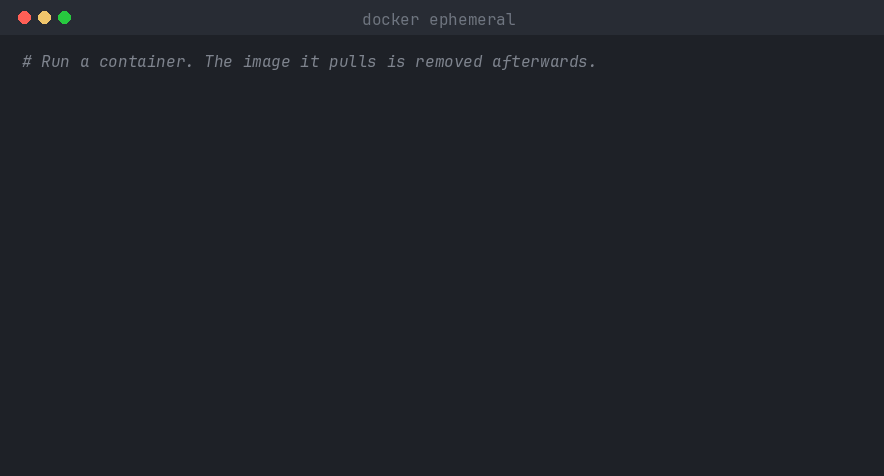

# docker ephemeral

[](https://github.com/wendersoon/docker-ephemeral/actions/workflows/ci.yml)
[](https://github.com/wendersoon/docker-ephemeral/releases)

A Docker CLI plugin that runs containers and Compose projects **without leaving
anything behind**. When the workload stops, every container, network, volume and
image it created is removed. Anything that existed before is left alone.



## Why

`docker run --rm` and `docker compose down -v --rmi all` cover part of the
problem, but they:

- cannot tell an image pulled *for this workload* from one you already had;
- remove nothing if the process is interrupted or killed;
- leave named volumes created implicitly by `-v name:/path` behind.

`docker ephemeral` tracks what each workload creates and removes exactly that.

## Installation

```sh
curl -fsSL https://raw.githubusercontent.com/wendersoon/docker-ephemeral/main/scripts/install.sh | sh
```

Or from source (Go 1.26+):

```sh
make install
```

Both place the binary in `~/.docker/cli-plugins` (or `$DOCKER_CONFIG/cli-plugins`).
Check the installation with `docker ephemeral version`.

## Usage

### Single container

`run` accepts the same arguments as `docker run`. The container runs in the
foreground; its exit code is preserved.

```sh
docker ephemeral run --rm -it alpine sh
docker ephemeral run -p 8080:80 -v site:/usr/share/nginx/html nginx
```

### Compose projects

```sh
# Start in the background and print the session ID
docker ephemeral up -f compose.yml --name api -- --build

# Inspect active sessions
docker ephemeral ls

# Remove the session and everything it created
docker ephemeral down api
```

With `--attach`, logs are followed and the session is removed as soon as you
press <kbd>Ctrl</kbd>+<kbd>C</kbd>:

```sh
docker ephemeral up --attach
```

### Commands

| Command | Description |
| --- | --- |
| `run [OPTIONS] IMAGE [COMMAND]` | Run a container and remove everything it created when it exits |
| `up [flags] [SERVICE...] [-- ARGS]` | Start a Compose project as a session |
| `down [SESSION...] [--all]` | Remove sessions by name, ID or ID prefix |
| `ls [-q]` | List active sessions |
| `gc` | Remove sessions left without running containers |
| `version` | Show version information |

Docker global options work as usual, e.g. `docker --context remote ephemeral ls`.

## How it works

1. **Baseline.** Before anything is created, the session records the images
   and volumes already on the host. Those are never removed.
2. **Ownership.** Session resources are found by label: containers from `run`
   get `io.github.wendersoon.ephemeral.session=<id>`, and Compose projects run
   under the dedicated project name `ephemeral-<id>`. The images and volumes
   used by those containers when the session starts are recorded; anything
   first used later is never considered the session's.
3. **Teardown.** Containers, networks, volumes and images are removed in
   dependency order. An image or volume that is still used by a container
   outside the session is kept and reported, and a tag the session took over
   (e.g. by pulling a newer `postgres:17`) is given back to the original image.
4. **Recovery.** State lives in `~/.docker/ephemeral/sessions`. If the plugin
   dies before cleaning up, `docker ephemeral gc` or `docker ephemeral down`
   finishes the job.

## Limitations

- An image pulled by another process *while* a session is starting, and used
  by it, is treated as the session's and removed with it.
- `run` always runs in the foreground; use `up` for background workloads.
- BuildKit cache is not pruned; use `docker builder prune` if needed.
- Bind mounts are host directories and are never touched.

## Development

```sh
make test              # unit tests
make test-integration  # end-to-end tests against the local Docker engine
make lint              # golangci-lint
```

The code follows a ports-and-adapters layout:

```
cmd/docker-ephemeral   entrypoint and wiring
internal/plugin        Docker CLI plugin protocol
internal/cli           cobra commands
internal/app           use cases (run, up, down, ls, gc)
internal/session       session model and persistence
internal/reaper        safe teardown of session resources
internal/engine        engine port, docker CLI adapter and in-memory fake
```

Contributions are welcome — see [CONTRIBUTING.md](CONTRIBUTING.md).
Commits follow [Conventional Commits](https://www.conventionalcommits.org).
Releases are built by GoReleaser when a `v*` tag is pushed.

## License

[MIT](LICENSE)
