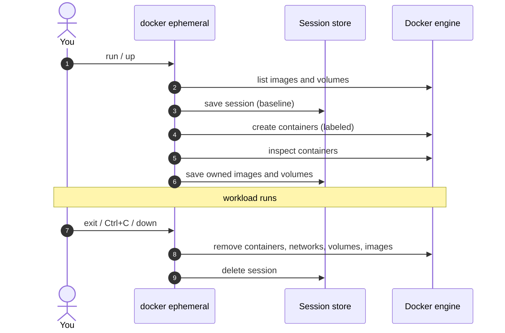
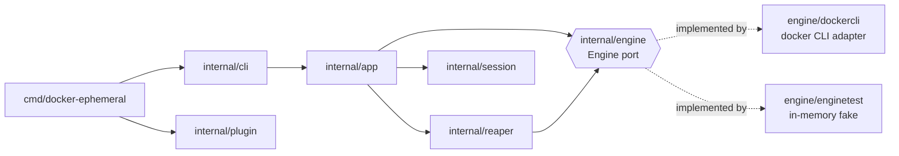

# How it works

`docker ephemeral` is a regular
[Docker CLI plugin](https://docs.docker.com/engine/extend/cli_plugins/): an
executable named `docker-ephemeral` in `~/.docker/cli-plugins`. The Docker CLI
runs it for `docker ephemeral ...`, and the plugin drives the engine through the
`docker` and `docker compose` commands, so it works with any engine, context or
platform the CLI supports.

## Sessions

Every workload runs inside a **session**: a small JSON document stored in
`~/.docker/ephemeral/sessions/<id>.json` that describes what the workload is
allowed to remove.

### 1. Baseline

Before anything is created, the session records the IDs of every image and
the name of every volume on the host. These form the **baseline** and are
never removed by this session.

Resources that belong to *other active sessions* are left out of the baseline:
they are shared rather than pre-existing, so whichever session ends last
removes them.

### 2. Ownership

Session resources are found through labels:

| Mode | Selector |
| --- | --- |
| `run` | `io.github.wendersoon.ephemeral.session=<id>` on the container |
| `up` | `com.docker.compose.project=ephemeral-<id>`, set by Compose on containers, networks and volumes |

Right after the containers are created, the plugin inspects them and records
the images and named volumes they use. Recording early matters: a container
started with `--rm` may already be gone when the session ends.

### 3. Teardown

Resources are removed in dependency order:

1. **Containers** matching the selector, together with their anonymous volumes.
2. **Networks** matching the selector.
3. **Volumes** matching the selector or recorded by the session, minus the baseline.
4. **Images** recorded by the session, minus the baseline. All of an image's
   tags are removed, then the image itself.

Anything still used by a container outside the session is kept and reported.
See [Safety guarantees](safety.md).

### 4. Recovery

Because the session is saved before the first resource is created, there is
always a record of what to clean up. If teardown is interrupted or fails, the
session stays in `docker ephemeral ls` and can be finished with `down` or `gc`.

## Termination

The plugin keeps running while the workload is in the foreground so it can
clean up afterwards:

- ++ctrl+c++ reaches the workload through the terminal; the plugin ignores it
  and starts the teardown once the workload exits.
- `SIGTERM` and `SIGHUP`, as well as termination requests sent by the Docker CLI
  through its plugin socket (`DOCKER_CLI_PLUGIN_SOCKET`), stop the workload
  gracefully and then tear the session down.

## Architecture

The code follows a ports-and-adapters layout:

| Package | Responsibility |
| --- | --- |
| `internal/plugin` | Docker CLI plugin protocol: metadata, argument parsing, termination |
| `internal/cli` | Cobra commands and output formatting |
| `internal/app` | Use cases: `Run`, `Up`, `Down`, `List`, `GC` |
| `internal/session` | Session model, file store and resolution by name/ID |
| `internal/reaper` | Safe, ordered removal of session resources |
| `internal/engine` | Engine port, docker CLI adapter and in-memory fake |
